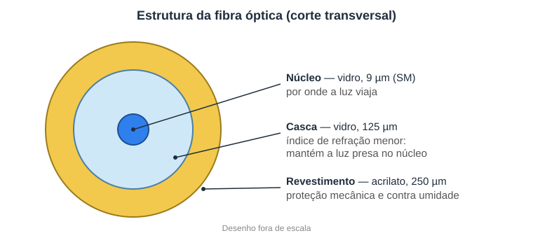
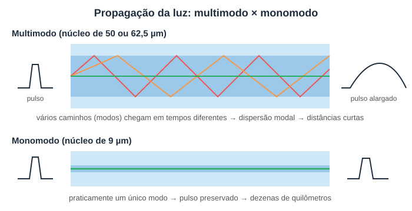
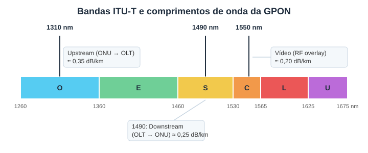
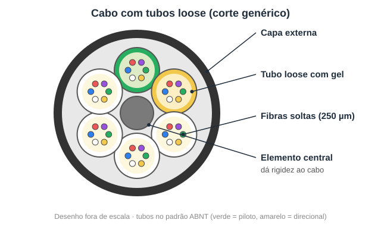
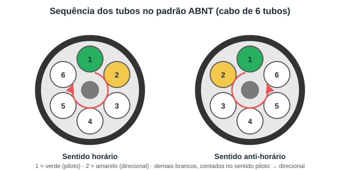
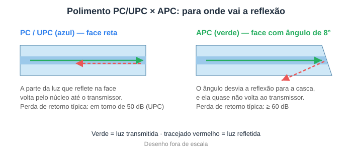

# Fibra Óptica — o básico

[← Voltar ao índice](README.md)

Resumo prático sobre fibras, cabos e conectores ópticos usados em redes FTTH: o que são, como funcionam e como identificar cada um em campo.

---

## 1. O que é a fibra óptica

A fibra óptica é um filamento de vidro (sílica) que conduz luz de um **transmissor** (laser ou LED) até um **receptor** (fotodiodo). É fina como um fio de cabelo, flexível e **dielétrica**: não conduz eletricidade, então não sofre interferência eletromagnética e não leva descarga elétrica de um prédio para outro.

## 2. Estrutura da fibra

A fibra tem três camadas:

- **Núcleo:** a parte central, por onde a luz viaja.
- **Casca:** envolve o núcleo. Também é de vidro, mas com **índice de refração um pouco menor**. Essa diferença faz a luz refletir na fronteira entre os dois (reflexão interna total) e continuar presa no núcleo.
- **Revestimento primário:** camada de acrilato que protege o vidro contra danos mecânicos e umidade. Com ele, a fibra fica com cerca de 250 µm.

> Núcleo e casca são os dois de vidro. O que muda entre eles é só o índice de refração.

## 3. Multimodo × monomodo

| Característica | Multimodo (MM) | Monomodo (SM) |
|---|---|---|
| Diâmetro do núcleo | 50 µm ou 62,5 µm | 9 µm |
| Diâmetro da casca | 125 µm | 125 µm |
| Comprimentos de onda | 850 nm e 1300 nm | 1310 nm a 1650 nm |
| Atenuação típica | 3,5 dB/km @ 850 nm · 1,0 dB/km @ 1300 nm | 0,35 dB/km @ 1310 nm · 0,20 dB/km @ 1550 nm |
| Fonte de luz | LED | Laser |
| Uso hoje | LANs de curta distância | Redes externas, LANs e **FTTH** |
| Normas ITU-T | G.651.1 | G.652, G.653, G.655, G.656, G.657 |

Na **multimodo**, o núcleo é largo e a luz segue vários caminhos (modos), refletindo nas paredes. Cada caminho tem um comprimento diferente, então partes do mesmo pulso chegam em momentos diferentes e o pulso "espalha". Isso se chama **dispersão modal** e limita a distância.

Na **monomodo**, o núcleo de 9 µm deixa passar praticamente um único modo, quase em linha reta. O pulso chega preservado, e por isso ela alcança dezenas de quilômetros com pouca perda.

## 4. Normas ITU-T

| Norma | Subtipos | Aplicação |
|---|---|---|
| G.652 | A, B, C, D | LAN, MAN, redes de acesso e CWDM |
| G.653 | A, B | Longas distâncias com amplificadores ópticos (EDFA), sem DWDM |
| G.654 | A, B, C | Backbones e cabos submarinos de alta capacidade |
| G.655 | A, B, C, D, E | Longas distâncias com DWDM |
| G.656 | — | Longas distâncias com CWDM e DWDM em faixas específicas |
| G.657 | A1, A2, B2, B3 | Redes FTTH (rede de atendimento / drop) |

Para FTTH, na prática, só duas importam: **G.652.D** na rede externa (alimentação e distribuição) e **G.657** no drop e na parte interna.

## 5. Fibras usadas em FTTH

### G.652.D — rede externa

- **Baixo pico d'água:** a atenuação perto de 1383 nm é reduzida, o que libera toda a faixa de 1260 a 1625 nm e permite usar **CWDM**. A antiga G.652.B não faz isso bem.
- **PMD melhorada** (dispersão dos modos de polarização), importante em taxas altas.
- Atenuação máxima: 0,4 dB/km de 1310 a 1625 nm e 0,3 dB/km em 1550 nm.
- Valores típicos: **0,35 dB/km @ 1310 nm**, **0,25 dB/km @ 1490 nm** e **0,20 dB/km @ 1550 nm**.
- **Cuidado:** é sensível a curvas fechadas, que geram perda alta. Não é boa para instalação interna.

Na GPON, a OLT **transmite em 1490 nm** (downstream) e **recebe em 1310 nm** (upstream). O 1550 nm fica reservado para vídeo (RF overlay).

### G.657 (BLI) — drop e rede interna

São fibras de **baixa sensibilidade à curvatura** (*Bend Loss Insensitive*). Podem ser dobradas em raios bem menores sem perda significativa, por isso são as indicadas para drops, PTOs e cabos internos.

- **Categoria A (A1, A2):** totalmente compatível com a G.652.D, pode ser emendada nela sem problema.
- **Categoria B (B2, B3):** aceita raios ainda menores.
- Para o drop, prefira **G.657.A2/B2 ou G.657.B3**.

Perda máxima por macrocurvatura segundo a ITU-T:

| Raio (mm) | Voltas | λ (nm) | G.652.D | G.657.A1 | G.657.A2 / B2 | G.657.B3 |
|---|---|---|---|---|---|---|
| 30 | 100 | 1625 | 0,1 dB | — | — | — |
| 15 | 10 | 1550 | — | 0,25 dB | 0,03 dB | — |
| 15 | 10 | 1625 | — | 1,0 dB | 0,1 dB | — |
| 10 | 1 | 1550 | — | 0,75 dB | 0,1 dB | 0,03 dB |
| 10 | 1 | 1625 | — | 1,5 dB | 0,2 dB | 0,1 dB |
| 7,5 | 1 | 1550 | — | — | 0,5 dB | 0,08 dB |
| 7,5 | 1 | 1625 | — | — | 1,0 dB | 0,25 dB |
| 5 | 1 | 1550 | — | — | — | 0,15 dB |
| 5 | 1 | 1625 | — | — | — | 0,45 dB |

**Leitura prática:** uma volta com raio de 1 cm (2 cm de diâmetro) em 1550 nm custa 0,75 dB numa G.657.A1, 0,1 dB numa A2/B2 e 0,03 dB numa B3. Na G.652.D essa perda nem é especificada, porque é alta. Por isso: **cuidado com as fibras do drop**.

## 6. Cabos ópticos

### Cabos com tubo loose

- As fibras (com 250 µm) ficam **soltas** dentro de tubos plásticos, com um comprimento um pouco maior que o do tubo.
- Essa folga deixa a fibra se acomodar quando o cabo dilata ou contrai com a temperatura e a protege durante o lançamento.
- O tubo costuma ser preenchido com **gel** que impede a entrada de água.
- Os tubos ficam em volta de um **elemento central**, que dá rigidez ao cabo, e a capa externa fecha o conjunto.
- Os cabos externos **DD** (duto) e **AS** (autossustentado) são feitos assim.

### Qual cabo usar em cada parte da rede FTTH

| Parte da rede | Cabo recomendado |
|---|---|
| Backbone e rede de alimentação | AS-80 |
| Rede de ramais (distribuição) | AS de tubo único |
| Atendimento ao cliente | Drop compacto |

O material de referência recomenda **evitar o drop figura 8 (F8)** e preferir o drop compacto.

### Como ler a nomenclatura

**Cabo para duto** — exemplo: `CFOA-SM-DD-G-36 FO`

| Campo | Significado |
|---|---|
| CFOA | Cabo de fibra óptica revestida em acrilato |
| SM / MM | Monomodo / multimodo |
| DD / DDR / DE | Duto / duto com proteção contra roedores / diretamente enterrado |
| G / S | Geleado / seco (seco só para rede aérea) |
| 36 FO | Número de fibras (até 144, em grupos de 2, 6 ou 12) |

**Cabo aéreo autossustentado** — exemplo: `CFOA-SM-AS-80-G-12 FO-NR`

| Campo | Significado |
|---|---|
| AS / ASU | Autossustentado / autossustentado com tubo único |
| 80 / 120 / 200 | Vão máximo entre postes, em metros |
| G / S | Geleado / seco |
| 12 FO | Número de fibras (até 144; tubo único até 12) |
| NR / RC | Capa não retardante / retardante à chama |

**Cabo drop** — exemplo: `DROP-F8-FTTH-SM-G652D-02 FO-COG`

| Campo | Significado |
|---|---|
| DROP | Cabo de atendimento ao cliente |
| F8-FTTH | Formato "figura 8", com mensageiro para ancoragem |
| SM-G652D | Tipo de fibra |
| 02 FO | Número de fibras (até 12, em um único grupo) |
| COG / LSZH | Retardante à chama / retardante com baixa emissão de fumaça tóxica |

**Drop compacto** — exemplo: `CFOAC-BLI-A/B-CM-01-AR-LSZH`

| Campo | Significado |
|---|---|
| CFOAC | Cabo de fibra óptica de acesso |
| BLI-A/B ou SM | Fibra G.657 (baixa sensibilidade à curvatura) ou monomodo padrão |
| CM / CD | Mensageiro compacto metálico / dielétrico |
| 01 | Número de fibras (em geral de 1 a 8) |
| AR / CO | Capa de atrito reduzido / convencional |
| LSZH / COG | Tipo de capa |

## 7. Código de cores

| Nº | Fibra — ABNT | Fibra — EIA-598-A | Tubo — ABNT | Tubo — EIA-598-A |
|---|---|---|---|---|
| 1 | Verde | Azul | Verde (piloto) | Azul |
| 2 | Amarelo | Laranja | Amarelo (direcional) | Laranja |
| 3 | Branco | Verde | Branco | Verde |
| 4 | Azul | Marrom | Branco | Marrom |
| 5 | Vermelho | Cinza | Branco | Cinza |
| 6 | Violeta | Branco | Branco | Branco |
| 7 | Marrom | Vermelho | Branco | Vermelho |
| 8 | Rosa | Preto | Branco | Preto |
| 9 | Preto | Amarelo | Branco | Amarelo |
| 10 | Cinza | Violeta | Branco | Violeta |
| 11 | Laranja | Rosa | Branco | Rosa |
| 12 | Aqua | Aqua | Branco | Aqua |

No padrão **ABNT**, só os dois primeiros tubos têm cor: o **verde é o piloto** (tubo 1) e o **amarelo é o direcional** (tubo 2). Do 3º em diante todos são brancos, e a contagem segue do piloto na direção do direcional. Dependendo da ponta do cabo que você está olhando, esse sentido aparece horário ou anti-horário.

> Antes de abrir uma emenda, identifique o piloto e o direcional **na ponta do cabo que está na sua mão**.

## 8. Numeração das fibras no cabo

Cada fibra recebe um número sequencial: os primeiros números são do tubo 1, os seguintes do tubo 2, e assim por diante.

- **Cabos de 48 a 144 FO** (12 fibras por tubo): `nº = (tubo − 1) × 12 + posição da cor`
  Exemplo: tubo 3, fibra azul (4ª cor ABNT) → 2 × 12 + 4 = **28**
- **Cabos de 18 a 36 FO** (6 fibras por tubo): `nº = (tubo − 1) × 6 + posição da cor`
  Exemplo: tubo 4, fibra vermelha (5ª cor ABNT) → 3 × 6 + 5 = **23**

## 9. Conectores ópticos

### Tipos mais comuns

| Conector | Nome | Observação |
|---|---|---|
| ST | Straight Tip | Encaixe tipo baioneta; comum em equipamentos antigos multimodo |
| FC | Fiber Channel | Rosqueado; usado em equipamentos de medição |
| SC | Subscriber / Square Connector | Encaixe por pressão; **padrão das portas PON** |
| LC | Lucent Connector | Pequeno, metade do tamanho do SC; comum em SFP e switches |

### Polimento: PC, UPC e APC

| | PC / UPC (azul) | APC (verde) |
|---|---|---|
| Face do ferrolho | Reta (levemente arredondada) | Com ângulo de 8° |
| Indicado para | Sistemas digitais abaixo de 10 Gbps | Vídeo analógico (RF) e sistemas digitais de 10 Gbps ou mais |
| Observação | Entre os azuis, o UPC tem o melhor desempenho. As portas PON usam SC/UPC | **Melhor opção para DIO e CTO** |

O APC é melhor que o PC **não por ter menor perda de inserção**, mas por **refletir menos luz de volta**. O ângulo de 8° desvia a reflexão para a casca, então ela quase não volta ao transmissor. Em outras palavras, o APC tem **maior perda de retorno**, o que evita erros em equipamentos de alta taxa e ruído em sinais analógicos.

### Pode misturar?

| Conector | Adaptador | Conector | Resultado |
|---|---|---|---|
| Azul (UPC) | Azul | Azul (UPC) | ✅ Correto |
| Verde (APC) | Verde | Verde (APC) | ✅ Correto |
| Azul (UPC) | Verde | Azul (UPC) | ⚠️ Funciona, mas o certo é usar o adaptador da mesma cor |
| Verde (APC) | Azul | Verde (APC) | ⚠️ Funciona, mas o certo é usar o adaptador da mesma cor |
| Azul (UPC) | qualquer | Verde (APC) | ❌ **Perda alta** — as faces não se encostam direito |

**Regra:** nunca ligue conector UPC em conector APC.

### Especificações (Anatel)

**Perda por inserção (PI)** — quanto menor, melhor:

| PI (dB) | Classe 1 | Classe 2 | Classe 3 |
|---|---|---|---|
| Valor médio | ≤ 0,50 | ≤ 0,30 | ≤ 0,15 |
| Valor máximo | ≤ 0,80 | ≤ 0,50 | ≤ 0,30 |

**Perda por retorno (PR)** — quanto maior, melhor:

| PR (dB) | Categoria A | Categoria B | Categoria C | Categoria D |
|---|---|---|---|---|
| Valor mínimo | 30 | 40 | 50 | 60 |

### Pigtail × cordão óptico

- **Pigtail (extensão óptica):** tem conector em **uma só ponta**. A ponta sem conector é emendada (fusão ou mecânica) na fibra do cabo, e a conectorizada vai no adaptador do DIO.
- **Cordão óptico (patch cord):** tem conector nas **duas pontas**. Liga o equipamento ativo (OLT, ONU, switch) ao DIO.

### Limpeza e inspeção

Sujeira no conector é uma das maiores causas de problema em rede óptica:

- A cada conexão, partículas passam de um conector para o outro.
- Partículas maiores (acima de ~5 µm) podem criar espaços de ar entre as faces e piorar o contato.
- Partículas menores tendem a se fixar na superfície e deixam riscos e lascas **permanentes** quando o conector é conectado e desconectado.
- O resultado é mais reflexão, mais perda de inserção e até dano em outros componentes.

Tipos comuns de contaminação: poeira, óleo/gordura da mão, lascas e riscos. **Sempre inspecione e limpe o conector antes de conectar**, inclusive os de cordões novos.

### Conectores pré-polidos e o clivador

O conector **pré-polido** (de montagem em campo) já vem com a ponta do ferrolho terminada e polida de fábrica. Para montar, basta clivar a fibra e inseri-la no conector, sem máquina de fusão. Por ser prático, é muito usado na terminação do drop, em caixas de terminação e na casa do assinante.

O resultado depende de um corte perfeito, por isso o **clivador é a ferramenta mais importante do técnico de fibra**. Use sempre um clivador de qualidade.

---

## Fontes

- COUTO, Ronaldo. *Projeto e Viabilidade de Redes FTTH*, rev. 30. Primori Desenvolvimento de Competências, 2018 — seções 3.1 a 3.3.
- COUTO JUNIOR, Ronaldo Bento. *Master em Redes FTTH*, rev. 3. Primori, 2019 — seção "Relembrando o básico".
- ITU-T G.652 e G.657 — recomendações para fibras monomodo.

Texto reescrito e figuras redesenhadas por Luis Gustavo dos Reis Kort Kamp, com complementos da experiência prática como projetista de redes FTTX.

[← Voltar ao índice](README.md)
