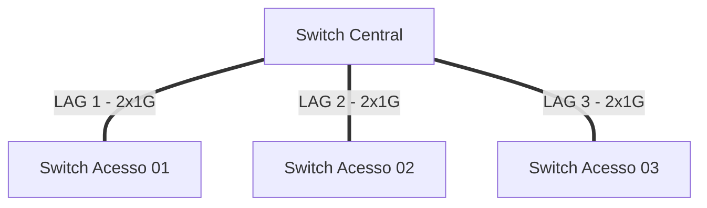

# LAG — Link Aggregation (Agregação de Links)

## O que é

LAG (Link Aggregation Group) é a técnica de **juntar várias portas físicas
em um único link lógico** entre dois equipamentos. Para o switch, as portas
agrupadas passam a funcionar como se fossem **uma porta só**.

Também é chamado de **EtherChannel** (Cisco), **Port-Channel**, **Trunk**
(em alguns fabricantes, como TP-Link e HP) ou **Bond** (Linux).

## Para que serve

- **Mais banda:** 2 portas de 1 Gbps formam um link de até 2 Gbps no total
- **Redundância:** se um cabo ou porta falhar, o tráfego continua pelos outros
  links, sem queda da rede
- **Sem loop:** ao contrário de ligar dois cabos soltos entre os switches,
  o LAG não é bloqueado pelo Spanning Tree — todos os links ficam ativos

## Cenário de exemplo



Um switch central ligado a vários switches de acesso, cada um com
**2 cabos** formando um LAG. Se um cabo for desconectado, o switch de acesso
continua com rede pelo outro.

## Ponto importante: a banda não "soma" para uma única conexão

O LAG **distribui as conexões entre os links**, mas **cada conexão
(fluxo) usa apenas um link**. Ou seja:

- Uma cópia de arquivo entre dois computadores → limitada a **1 Gbps**
- Muitos usuários ao mesmo tempo → o tráfego total se espalha e pode chegar a **2 Gbps**

A escolha do link é feita por um cálculo (*hash*) baseado em endereço MAC,
IP e/ou porta de origem e destino. Esse método pode ser ajustado no switch.

## Tipos de LAG

### Estático (modo `on`)
As portas são agrupadas "na marra", sem negociação entre os switches.
- Funciona entre quase qualquer equipamento
- **Risco:** se um lado estiver configurado errado, pode gerar loop ou
  perda de pacotes sem nenhum aviso

### Dinâmico com LACP (recomendado)
**LACP** (Link Aggregation Control Protocol) é o protocolo padrão
**IEEE 802.3ad** (hoje **802.1AX**). Os switches trocam mensagens para
confirmar que os dois lados estão de acordo antes de ativar o grupo.
- Detecta cabos ligados errado e links com problema
- Retira do grupo automaticamente um link que falhou

Modos do LACP:

| Modo      | Comportamento                                  |
|-----------|-----------------------------------------------|
| `active`  | Envia mensagens LACP e tenta formar o grupo    |
| `passive` | Só responde se o outro lado iniciar            |

- `active` + `active` → **funciona** (recomendado)
- `active` + `passive` → **funciona**
- `passive` + `passive` → **não forma o LAG**

## Requisitos

Todas as portas do grupo devem ter:
- **Mesma velocidade** e **mesmo duplex** (ex.: todas 1 Gbps full)
- **Mesma configuração de VLAN** (mesmo modo, mesmas VLANs liberadas)
- Ligação entre **os mesmos dois equipamentos**
  (exceto em switches empilhados ou com MLAG/vPC)

## Configuração (exemplo em Cisco IOS)

### Switch central — portas 1 e 2 formando o LAG 1
```
configure terminal
interface range GigabitEthernet0/1 - 2
 description LAG1-SW-ACESSO-01
 channel-group 1 mode active
exit

interface Port-channel1
 description LAG1-SW-ACESSO-01
 switchport mode trunk
 switchport trunk allowed vlan 10,20,30,99
```

### Switch de acesso — mesma coisa do outro lado
```
configure terminal
interface range GigabitEthernet0/49 - 50
 description LAG-UPLINK-CORE
 channel-group 1 mode active
exit

interface Port-channel1
 description LAG-UPLINK-CORE
 switchport mode trunk
 switchport trunk allowed vlan 10,20,30,99
```

> **Dica:** depois de criado o LAG, configure VLANs e demais opções na
> interface **Port-channel**, não nas portas físicas. A configuração é
> repassada para as portas membros.

> **Outros fabricantes:** os conceitos são os mesmos, mas a sintaxe muda.
> Na linha Cisco Business (CBS), por exemplo, o LACP é ativado com
> `channel-group 1 mode auto`. Consulte o manual do seu modelo.

## Verificação
```
show etherchannel summary
show lacp neighbor
show interfaces Port-channel1
```

No `show etherchannel summary`, as portas devem aparecer com a flag **(P)**
— *bundled in port-channel*, ou seja, ativas no grupo.

## Erros comuns

- Configurar LACP de um lado e LAG estático do outro
- VLANs diferentes entre as portas do grupo → porta fica suspensa
- Ligar os cabos antes de configurar os dois lados → risco de loop
- Esperar que **uma única transferência** use a banda somada
- Misturar portas de velocidades diferentes no mesmo grupo

## Boas práticas

- Preferir **LACP** ao LAG estático
- **Configurar os dois lados antes** de conectar o segundo cabo
- Usar quantidades de links em potência de 2 (**2, 4 ou 8**) para melhor
  distribuição do tráfego
- Colocar **descrição** nas portas e no Port-channel indicando o destino
- Testar a redundância: desconecte um cabo e veja se a rede continua
- Documentar: qual LAG, quais portas, ligado a qual equipamento

---
Conteúdo sob licença CC BY 4.0 — Luis Gustavo dos Reis Kort Kamp.
